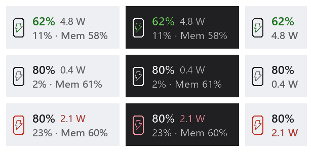
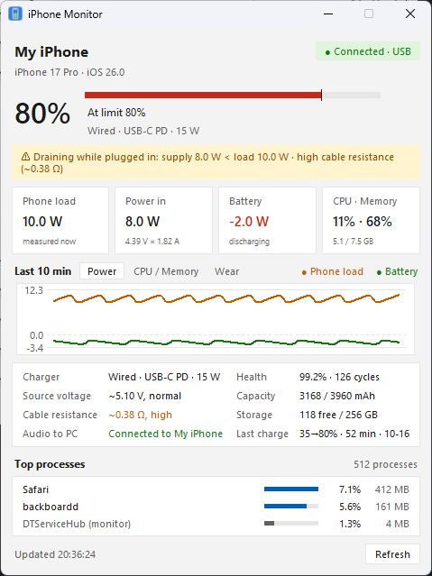
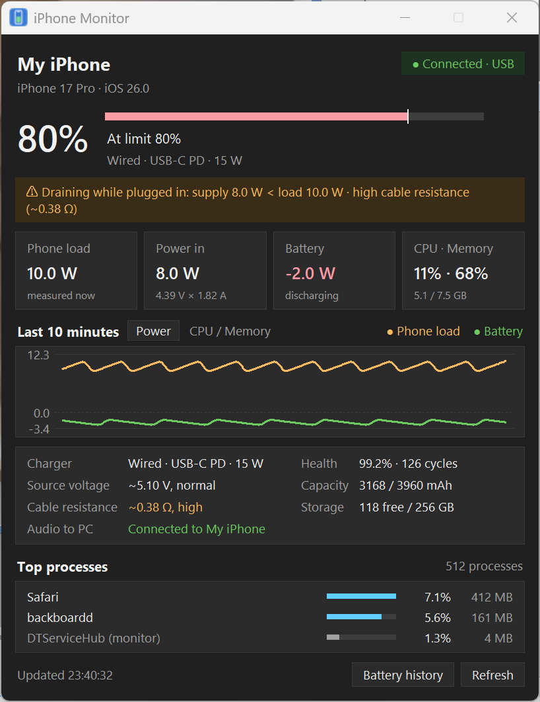
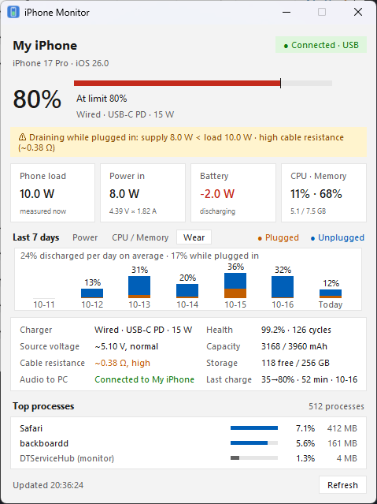

# iPhone Monitor

English | [简体中文](README.zh-CN.md)

A lightweight Windows taskbar tool that shows a USB-connected iPhone's **battery, power draw, CPU and memory** in real time, and helps you figure out *why your iPhone is still draining while plugged in*. No jailbreak, nothing to install on the phone.



> The UI is available in **English** and **Simplified Chinese**. It follows the Windows display language; switch it from the right-click menu → **语言 / Language**.

## Features

- **Taskbar strip** embedded in the Windows 11 taskbar: phone icon (bolt inside while charging, red while the battery is discharging), battery %, whole-phone power draw, and the phone's CPU and memory on the second line. Place it next to the tray or next to the widgets on the left; it switches to a compact layout when the taskbar gets crowded and falls back to a tray icon if there is no room.
- **Details window**: system load, external supply (voltage × current), battery in/out power, 10-minute charts, and the processes using the most CPU. Docks to the screen corner and follows light/dark mode.
- **Power supply diagnosis**: estimates the **source voltage** and **line resistance** from voltage/current samples (V = V₀ − I·R), so you can tell a bad cable from a weak port or a heavy workload. Alerts when the phone drains while plugged in or charges slowly.
- **Charging insights**: charge limit (kept in sync with the phone setting by you), time-to-full estimate, daily battery health log, and a record of every charging session.
- **Battery wear**: a 7-day view in the details window showing how much of the battery was discharged each day, plugged in vs unplugged, measured from the phone's own energy counters (finer than the phone's whole-percent stats), so you can see where your cycle count comes from.
- **Laptop battery**: the details window has a second page for the PC's own battery (charge/discharge power, voltage, health from design vs full capacity, cycle count, 10-minute power chart, daily wear), and warns when the laptop drains while plugged in, e.g. on a charger or dock that is too weak.
- **Phone audio on your PC**: turns the PC into a Bluetooth speaker for the iPhone (A2DP sink), so phone audio plays through the headphones already plugged into your PC.
- **Hotspot takeover warning**: warns when the iPhone's Personal Hotspot over USB takes over the PC's network.
- **Lightweight**: about 0.1% of one core on the PC with the window closed; monitoring itself costs about 1–2% of one core on the phone.

<p>


</p>


## Getting started

1. Install **Apple Devices** from the Microsoft Store (required; it provides the Apple Mobile Device Service).
2. Download `iPhoneMonitor.zip` from [Releases](https://github.com/by1907047/iphone_monitor/releases/latest), unzip it anywhere, and run `iPhoneMonitor.exe`.
3. Connect the iPhone with a data cable, unlock it, and tap **Trust This Computer**.
4. *(Optional)* For CPU / memory: enable **Developer Mode** on the iPhone (Settings → Privacy & Security → Developer Mode; the phone restarts once). On first use the app mounts the developer disk image automatically — keep the phone unlocked while it does.

The exe is not code-signed, so Windows SmartScreen may warn on first launch: click **More info → Run anyway**. Each release lists the SHA256 of the zip.

Logs, settings and history are stored in `%APPDATA%\iPhoneMonitor`.

### Requirements

- Windows 10 2004 or later; the taskbar strip is designed for (and tested on) the Windows 11 taskbar.
- An iPhone on iOS 17 or later (tested on iPhone 18 Pro / iOS 27.0.1).
- Developer Mode is only needed for CPU / memory; battery, power and charging insights work without it.

### Run from source / build

```bash
pip install -r requirements.txt
```

Run `start.bat` (no console window). `build_exe.bat` builds `dist\iPhoneMonitor\iPhoneMonitor.exe` and `dist\iPhoneMonitor.zip` in a dedicated `.build-venv`. Pushing a `v*` tag makes GitHub Actions build and publish a release.

## How it works

| Data | Source |
|---|---|
| Battery, power, charger, health | `diagnostics_relay` IORegistry (`IOPMPowerSource`) over usbmux — no developer mode |
| CPU, memory, processes | Instruments `sysmontap` over an in-process userspace tunnel (iOS 17+), developer disk image mounted |
| Taskbar layout | Windows UI Automation (Windows 11 taskbar buttons are XAML) |
| Bluetooth audio | `Windows.Media.Audio.AudioPlaybackConnection` |

Built on [pymobiledevice3](https://github.com/doronz88/pymobiledevice3). Two continuous-monitoring costs found while building this were fixed upstream in pymobiledevice3 11.33.1 / pmd-pytcp 0.3.8 ([#2037](https://github.com/doronz88/pymobiledevice3/issues/2037), [#2038](https://github.com/doronz88/pymobiledevice3/issues/2038)): `sysmontap` emitting every 1 ms (`DTServiceHub` on the phone ~20% → ~3% of a core) and the tunnel's delayed-ACK timer re-arming forever (~4% → ~1% of a core on the PC).

## Privacy

Everything stays on your PC; there is no telemetry. The only network access is downloading the developer disk image from [doronz88/DeveloperDiskImage](https://github.com/doronz88/DeveloperDiskImage) and having it personalized by Apple's signing server — the same thing Xcode does — and only if you enable CPU / memory monitoring.

## More

- Project page: https://by1907047.github.io/iphone_monitor/
- Write-up (Chinese, Bilibili): [插着电脑 iPhone 还掉电？我写了个小工具把原因找出来](https://www.bilibili.com/opus/1260161164381257800)
- Sibling project: [apple-usb-ncm](https://github.com/by1907047/apple-usb-ncm), a Windows driver for direct Mac–PC networking over one USB-C cable

## License

[GPL-3.0-or-later](LICENSE). See [THIRD_PARTY_NOTICES.md](THIRD_PARTY_NOTICES.md) for bundled components.

iPhone, iOS and MagSafe are trademarks of Apple Inc. This project is not affiliated with Apple.
