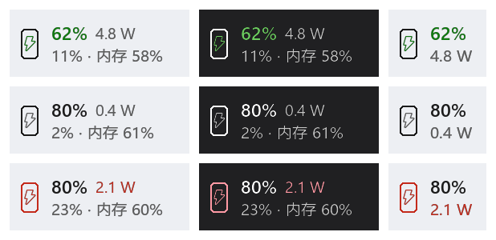
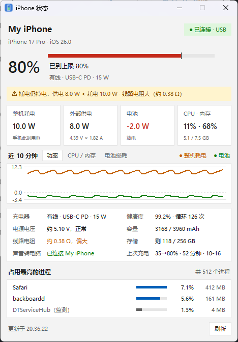
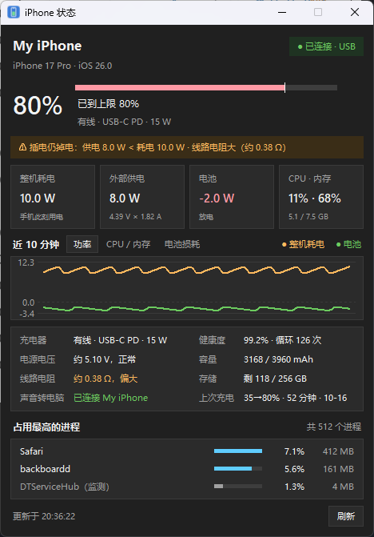
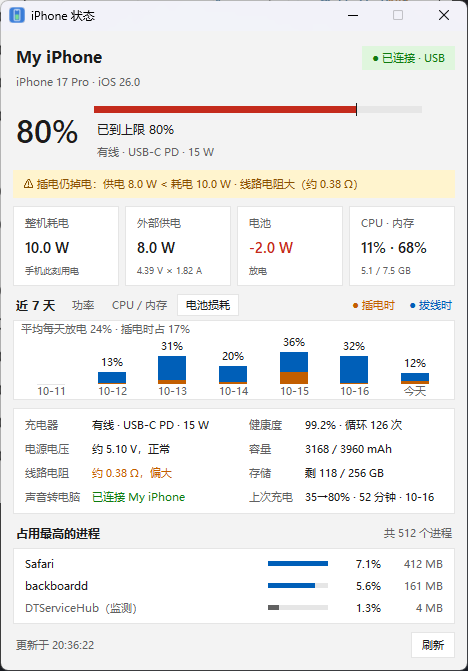

# iPhone Monitor（iPhone 状态监测）

[English](README.md) | 简体中文

在 Windows 任务栏上实时显示 USB 连接的 iPhone 的**电量、功耗、CPU 和内存**，并帮你诊断「插着线为什么还在掉电」。不需要越狱，手机上也不用装任何 App。



## 主要功能

- **任务栏文字条**：手机图标（充电时内含闪电，电池放电时变红）+ 电量 + 整机功耗，第二行显示手机的 CPU 和内存。可放在托盘旁或左侧小组件旁；任务栏变挤时自动切换窄版，实在放不下就改用托盘图标。
- **详情窗口**：整机耗电、外部供电（电压 × 电流）、电池充入/放电、10 分钟曲线、占用最高的进程。贴着屏幕角落弹出，跟随深色/浅色模式。
- **供电诊断**：自动估算**电源电压**和**线路电阻**，判断是线不好、电脑口不行，还是手机负载太高；插着线仍在掉电、充电慢时提醒。
- **充电分析**：充电上限（与手机设置同步）、预计充满时间、每天的电池健康记录、每次充电的记录。
- **电池损耗统计**：用手机自带的能量计数，按天统计插电时、拔线时各放电多少，折算成循环次数，看清循环次数是怎么涨的。
- **手机声音转到电脑**：通过蓝牙把电脑变成 iPhone 的音箱，声音直接从电脑耳机出来。
- **热点接管网络提醒**：iPhone 个人热点通过 USB 抢走电脑网络（单位内网打不开）时提醒你。
- **中英双语**：默认跟随 Windows 显示语言，可在右键菜单「语言 / Language」里切换。
- **轻量**：窗口关着时电脑端约 0.1% 单核；手机端每次查询都按需进行，监测本身在手机上约占单核 1–2%。

<p>


</p>


## 下载和使用

1. 在微软商店安装 **Apple Devices**（必须，提供 Apple Mobile Device Service）。
2. 在 [Releases](https://github.com/by1907047/iphone_monitor/releases/latest) 下载 `iPhoneMonitor.zip`，解压到任意位置，双击 `iPhoneMonitor.exe`。
3. 用数据线连接 iPhone，解锁手机，点「信任此电脑」。
4. （可选）想看 CPU / 内存：在 iPhone「设置 → 隐私与安全性 → 开发者模式」打开开发者模式（会重启一次）。第一次读取时，程序会自动挂载开发者镜像，挂载时手机需要保持解锁。

exe 没有数字签名，第一次运行时 Windows 可能提示「已保护你的电脑」，点「更多信息 → 仍要运行」即可。Release 页面附有 SHA256 校验值。

日志、设置和历史记录保存在 `%APPDATA%\iPhoneMonitor`。

### 系统要求

- Windows 10 2004 及以上；任务栏文字条按 Windows 11 的任务栏设计（在 Windows 11 上测试过）。
- 支持 iOS 17 及以上的 iPhone，在 iPhone 18 Pro / iOS 27.0.1 上测试过。
- 看 CPU / 内存需要开发者模式；电量、功耗、充电分析不需要。

### 从源码运行 / 自己打包

```bash
pip install -r requirements.txt
```

双击 `start.bat` 运行（后台运行，没有控制台窗口）。双击 `build_exe.bat` 打包成 `dist\iPhoneMonitor\iPhoneMonitor.exe` 和 `dist\iPhoneMonitor.zip`；它会建一个独立的 `.build-venv` 环境，只装需要的库。打 `v*` 标签后，GitHub Actions 会自动打包并发布到 Releases。

## 详细说明

### 用法

- **托盘图标**：默认显示电量 %。绿色表示充电中或已充满，红色表示电量 ≤ 20%，蓝色表示正在用电池；图标底部有白线表示已接电源；灰色 `--` 表示未连接。
- **左键单击**：打开或关闭详情窗口。窗口从上到下依次是：
  - 电量大字和电池条（竖线标出充电上限）、状态、预计充满时间、电源；
  - 提示条（充电诊断、热点接管网络，正常时不显示）；
  - 四张数字卡：整机耗电、外部供电（电压 × 电流）、电池（充入 / 放电）、CPU · 内存；
  - 曲线区可切换「功率」「CPU / 内存」（近 10 分钟）和「电池损耗」（近 7 天每天放电量）；
  - 「电源」和「电池与存储」两栏明细（含上次充电）；
  - 占用最高的进程；
  - 「刷新」按钮。
  - 跟随 Windows 深色 / 浅色模式。电池温度在 iOS 27 下读不到，就不显示这一行。
- **右键菜单**：
  - 图标显示：电量 %、电池功率 W、温度 °C（机型提供温度时才可选）
  - 刷新间隔：1、2、5、10 秒
  - CPU / 内存监测（开关）
  - 仅通过 USB 连接（默认开；详情窗口右下角也有这个勾选框）
  - 详情窗口置顶
  - 开机自动启动（写入 `HKCU\...\Run`，再点一次取消）
- **通知**：电量低于 20%、温度 ≥ 40°C、充满时会弹出提醒。

### 任务栏文字条

托盘区左边会挂一块小文字条：

```
[手机图标]  80%  0.9 W        ← 电量 + 整机功耗
            11% · 内存 58%    ← CPU（不带字母）+ 内存
```

- **手机图标里的闪电**：绿色表示充电中，灰色表示接着电源但暂停充电（比如到了 80% 上限），没接电源时不显示。
- **电池在放电时，图标和功耗变红**。插着线也可能放电，比如电脑 USB 口供电不够，或者停在充电上限时由电池供电。判断标准是电池功率低于 −0.1 W。
- 电量颜色：绿色表示充电中，红色表示 ≤ 20% 且没接电源，平时跟随任务栏文字颜色。
- 关掉「第二行显示 CPU / 内存」后只显示一行（电量 + 功耗），开发者通道也不会常开。
- CPU / 内存读不到时，第二行会提示原因：「需开发者模式」「解锁手机读取」「需 USB 连接」。
- **左键**打开或关闭详情窗口；**右键**弹出完整设置菜单（第二行显示 CPU / 内存、CPU / 内存监测、仅通过 USB 连接、刷新间隔、置顶、开机自动启动、显示托盘图标、退出）。
- **没插手机时整块不显示**：断开 5 秒后收起，插上后自动出现。
- **默认不显示托盘图标**，需要时在右键菜单里勾「显示托盘图标」。关掉文字条后托盘图标会自动回来，保证程序总有入口。低电量、充满、热点接管网络这些通知会临时显示托盘图标约 10 秒（Windows 的通知必须挂在托盘图标上）。
- 手机没插、什么都看不到的时候，**再运行一次 `start.bat`（或 exe）** 会打开详情窗口；在详情窗口上右键也能弹出同一个设置菜单。
- **位置**：右键菜单「文字条位置」里选「靠右（托盘旁）」或「靠左（小组件旁，紧挨左侧的天气小组件）」。详情窗口跟着文字条，在左边就贴左下角弹出，在右边就贴右下角。启动时会等读到任务栏布局后再显示，不会先压在天气小组件上。
- **自动适应任务栏**：程序每 3 秒用 Windows 的 UI 自动化接口读一次任务栏图标的实际位置（Windows 11 的旧窗口结构不反映真实图标位置），然后按下面的顺序找位置：
  1. 选定那一侧放完整版；
  2. 放不下就在同一侧放窄版（只显示电量和功率，宽度约一半）；
  3. 还放不下就换到另一侧，同样先完整版、再窄版；
  4. 两侧都放不下就隐藏文字条，托盘图标自动出现。
  
  图标变少后会自动恢复。Windows 11 没有让任务栏给第三方内容预留空间的正规接口，所以只能由文字条来避让。
- 自动跟随任务栏的深色或浅色模式，资源管理器重启后会自动重新挂上。
- 第二行显示 CPU / 内存时，开发者通道会一直开着，程序约占单核 2%，内存约 110 MB。只显示一行时约 0.1–0.3%。
- 实现方式：在任务栏窗口（`Shell_TrayWnd`）下挂一个逐像素透明的分层子窗口。Windows 大版本更新如果改了任务栏结构，可能需要适配。出问题时在菜单里关掉文字条即可，托盘图标不受影响。

### 充电分析

- **充电上限**：在右键菜单「充电上限（与手机设置一致）」里选 80/85/90/95/100%，和 iPhone「设置 → 电池 → 充电」保持一致。程序读不到手机上的设置，所以需要手动同步。到上限后显示「已到上限 80%」。
- **预计充满时间**：详情窗口「充电情况」显示「约 25 分钟到 80%」。目标是充电上限，计算依据是平滑后的充电电流和电池容量。接近充满时 iPhone 会主动降速，所以最后一段会比估计的慢。
- **充电诊断**：
  - 插着线仍在掉电（不在上限时）：列出原因，比如输入功率小于手机耗电、电源只有几瓦、开着热点、手机负载高。持续 2 分钟后提醒一次。
  - 到上限后手机暂用电池供电：如果外部输入够用，标记为正常，不提醒；如果输入比耗电少 0.5 W 以上，就算供电不够，照样提醒。
  - **电源电压 / 线路电阻**：程序持续记录不同电流下手机端的输入电压，拟合 V = V0 − I × R。V0（电流为零时的电压）就是电源（电脑口 / 充电器）实际输出的电压，R 是线材 + 接头 + 电源内部的总电阻。V0 低于 4.75 V 说明电源本身电压偏低；R 超过 0.2 Ω 说明线路电阻偏大，换一根短而好的线。需要电流变化至少 0.5 A 才能算出来；换充电器或换线后会重新统计。
  - 线材压降：手机端实测的输入电压比充电器标称低 0.4 V 以上（比如 5 V 到手机只剩 4.4 V）时会写进原因。电压一掉，手机会主动限制电流，实际能拿到的功率远低于标称。
  - 慢充（离目标还远、充入功率 < 2.5 W）：持续 5 分钟后提醒一次。
- **电池损耗**（详情窗口曲线区的「电池损耗」）：
  - 近 7 天每天放电多少（占电池容量的百分比，可以和手机「设置 → 电池」的每日用量对照），分插电时 / 拔线时两段叠在一起，上方一行是日均放电和插电时的占比。
  - 数据来自手机自己的电池能量计数（开机以来每秒累加），比手机按整数百分比统计更细，停在充电上限附近的小幅放电也算得到。离开电脑的那段时间，下次连上时一次补算。
  - 另外每天记一次健康度和循环次数，每次充电记一条（起止电量、时长、充入 Wh、电源），明细里的「上次充电」就来自这里。
  - 数据保存在 `%APPDATA%\iPhoneMonitor` 下的 `battery_wear.json`、`battery_health.csv` 和 `charge_sessions.jsonl`。

### 手机声音转到电脑（蓝牙）

把电脑变成 iPhone 的蓝牙音箱，手机的声音从电脑当前的输出设备（比如你的耳机）播放，不用来回切换耳机。

- 用的是 Windows 10 2004 以后系统自带的蓝牙音频接收（A2DP Sink）接口，不需要第三方应用。
- 第一次用：先在系统里把 iPhone 和电脑配对蓝牙，再在右键菜单勾「手机声音转到电脑（蓝牙）」。
- 打开后自动连接，断开后自动重连（重试间隔 10 秒起，最长 60 秒）。详情窗口「声音转到电脑」一行显示连接状态，连上时会弹通知。
- 如果声音还在手机上：控制中心 → 长按音乐卡片 → 音频输出 → 选这台电脑。
- 有约 0.1–0.3 秒延迟，听歌、看视频没问题。打电话请用 Windows 11 自带的「手机连接」(Phone Link)。
- 和 USB 无关，走的是蓝牙，手机不插线时也能用。

### CPU / 内存监测

详情窗口右栏显示整机 CPU 占用、内存占用、进程数、CPU 占用最高的 6 个进程，以及近 10 分钟的 CPU / 内存曲线。托盘图标也可以切换成显示 CPU %。

需要先做一次准备：

1. **iPhone 开启开发者模式**：设置 → 隐私与安全性 → 开发者模式 → 打开，手机重启后确认。（如果没有这个选项，先运行 `pymobiledevice3 amfi reveal-developer-mode`。）
2. **必须用 USB 线连接**，Wi-Fi 下没有这个通道。
3. 程序会自动建立用户态隧道（不需要管理员权限），并挂载「开发者磁盘镜像」。第一次挂载需要下载约 16MB（来自 GitHub `doronz88/DeveloperDiskImage`，缓存在 `~/.pymobiledevice3`），并向 `gs.apple.com` 申请本机签名。镜像在手机重启后失效，程序会自动重新挂载。

注意事项：

- **按需连接，省电脑 CPU**：只有详情窗口打开时（或托盘图标设成显示 CPU %）才建立开发者通道，打开窗口约 5 秒后出数据；窗口关掉 60 秒后自动断开。
- **挂载镜像时手机必须是解锁状态**，锁屏时手机不回应，程序会提示并稍后重试。
- 采样本身在手机上有一点开销：`DTServiceHub` 和 `sysmond` 各约占单核 1%，进程列表里标为「监测自身」。采样间隔是 2 秒。

**开发者模式需要一直开着吗？** 只有 CPU / 内存需要它。电量、功耗、充电器、电池健康、存储都不需要。关掉以后，文字条第二行会显示「需开发者模式」，其他功能照常。重新打开需要在手机上开一次并重启，开发者镜像也要重新挂载（程序会自动挂载，挂载时手机要保持解锁）。

不想要的话，在右键菜单取消「CPU / 内存监测」。也可以在手机设置里关掉开发者模式。

### 无线（MagSafe）使用

默认**只通过 USB 连接**。即使手机开了 Wi-Fi 同步，程序也不会走网络。想无线读取时，取消详情窗口右下角的「仅通过 USB 连接」（托盘右键菜单里也有同一个开关），然后先插线连接一次，再开启 Wi-Fi 连接：

```bash
pymobiledevice3 lockdown wifi-connections on
```

之后手机和电脑在同一局域网即可，拔线也能读取。手机锁屏久了 Wi-Fi 可能休眠，程序会自动重连。

### 资源占用

实测（电脑 22 逻辑核，iPhone 18 Pro / iOS 27.0.1），百分比都按单核计：

| | 电脑端 CPU | 电脑端唤醒 | 手机端额外开销 |
|---|---|---|---|
| 详情窗口关着 | 约 0.1% | 不到 1 次/秒 | 只有电池查询（`mobile_diagnostics_relay` 约 0.2%，每 10 秒一次） |
| 详情窗口开着 | 约 1% | 约 80 次/秒 | `DTServiceHub` + `sysmond` 各约 1% |

内存约 78 MB，没有子进程。为了轻量做了这些：

- **窗口关着时放慢**：电池每 10 秒读一次（窗口开着、或图标显示功率时按设置的间隔），界面每秒刷新一次。只有文字条在显示时也是 10 秒。手机的功率遥测本身约 20 秒才更新一次，读得更勤也拿不到新数据，每次读取手机还要打包约 10 KB 的电池数据。
- **手机端 kernel_task**：实测锁屏空闲时约 2.7% 单核，绝大部分是手机自己的底噪。电池轮询和蓝牙音频各增加约 0.3%。kernel_task 约 160 MB 的内存是内核和驱动自己的，监测程序只增加几百 KB，从外部无法调整。
- 试过「只有文字条时 CPU 只订阅 pid、5 秒一次」的精简采样，手机整机 CPU 测不出差别（低于手机自身 1–3% 的波动），所以没有采用。
- **全部事件驱动**：后台不再定时轮询状态，点托盘图标等操作会立刻响应。
- **只订阅用到的数据**：进程只要名字、PID、CPU、内存 4 个字段（默认会订阅约 70 个），系统只要内存相关的 7 个字段。
- **上游已修复的两处开销**：开发过程中发现并报告给 pymobiledevice3 的两个问题已在 11.33.1 / pmd-pytcp 0.3.8 修复（[#2037](https://github.com/doronz88/pymobiledevice3/issues/2037)、[#2038](https://github.com/doronz88/pymobiledevice3/issues/2038)）：采样输出频率写死 1 ms（`DTServiceHub` 从约 20% 降到约 3%），以及隧道延迟 ACK 定时器空转（电脑端从约 4% 降到约 1%）。
- **热点检测**直接调用 Windows 网络 API（每次约 0.2 ms），不再启动 PowerShell（原来每次要 3.5 秒 CPU）。
- **开发者通道相关的模块按需加载**，只看电池时不加载。

### 连接方式与电脑网络

- 程序**不用 Wi-Fi，也不改电脑的网络设置**。USB 连接时，数据走 Apple 设备服务的 USB 数据通道（usbmux）；CPU / 内存走程序内部的用户态隧道，只在本进程内有效，不会添加网卡或路由。
- **注意 iPhone 个人热点**：装了 Apple Devices 之后，Windows 会多出一块「Apple Mobile Device Ethernet」网卡。如果手机开着个人热点，插上线电脑就会通过它上网（拿到 172.20.10.x 的地址），而且优先级比 WLAN 高，单位内网网站会打不开。
  - 最简单：关闭 iPhone「设置 → 个人热点 → 允许其他人加入」。
  - **想开着热点又不影响电脑**：在**管理员**终端运行下面这行，把这块网卡的优先级调到最低（同时写入持久和当前设置，重新插拔、开关热点后也有效）：

    ```bash
    $i=(Get-NetAdapter -InterfaceDescription 'Apple Mobile Device Ethernet*').ifIndex; Set-NetIPInterface -InterfaceIndex $i -InterfaceMetric 9999 -PolicyStore PersistentStore; Set-NetIPInterface -InterfaceIndex $i -InterfaceMetric 9999 -PolicyStore ActiveStore
    ```

    不加 `-PolicyStore PersistentStore` 只改临时设置，热点一重连就失效；不在管理员终端运行会被拒绝。这个设置跟着具体的网卡实例走，换 USB 口后如果出现了新的网卡（比如「以太网 4」），要再运行一次。WLAN 断开时，电脑会自动改用手机热点上网。
  - 不需要通过 USB 用热点的话，也可以在「控制面板 → 网络连接」里禁用「Apple Mobile Device Ethernet」，监测不受影响。
  - 程序每 15 秒检查一次（直接调用 Windows 网络 API，几乎不占 CPU），**只有外网流量真的走了手机热点**时才弹通知、在详情窗口顶部显示红色警告。按上面调过优先级的话，热点开着也不会报警。

### 数据说明

| 项目 | 来源 |
|---|---|
| 电池功率 | `PowerTelemetryData.BatteryPower`。正数表示充入电池，负数表示放电。没有遥测数据时用 电压 × 电流 计算 |
| 整机耗电 | `PowerTelemetryData.SystemLoad`（实测）。没有遥测数据时用放电功率估算 |
| 输入功率 | `PowerTelemetryData.SystemPowerIn`，即从充电器实际取用的功率 |
| 电池健康 | NominalChargeCapacity / DesignCapacity。新电池超过 100% 属于正常 |

- iOS 27 不再提供电池温度，温度显示为「未提供」。
- CPU 占用 = `CPU_TotalLoad` ÷ 核心数（整机平均）。进程列表里的 CPU% 按单核计算，所以可能超过 100%。
- 连接时 Windows 可能弹出「无法识别的 USB 设备」，这是 iPhone 的 USB 网络共享接口（AppleUSBEthernet）引起的，不影响使用。

### 文件

- `app.py`：托盘图标、详情窗口、菜单
- `monitor.py`：后台采集与自动重连
- `monitor.log`：运行日志
- `last_battery_raw.json`：最近一次连接时的原始电池数据，排查字段问题时用，里面含序列号，不要外传
- `detail_window.py`：详情窗口（含近 7 天电池损耗）；`ui_common.py`：配色和格式化
- `insights.py`：充电分析；`bt_audio.py`：蓝牙音频；`taskbar_strip.py`：任务栏文字条
- 设置保存在 `%APPDATA%\iPhoneMonitor\settings.json`
